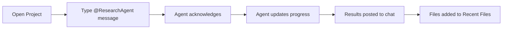

This **Product Requirements Document (PRD)** outlines the development of **Chad Jubilee**, an AI-powered research and project management platform.

---

# PRD: Chad Jubilee (v2.0)

**Project Code Name:** NEXUS_COMMAND

**Tagline:** *Your AI Research Command Center*

---

## 1. Executive Summary

Chad Jubilee is an AI-first project management and research platform. It deploys specialized AI agents to perform research tasks, analyze competitors, generate content, and synthesize findings—all orchestrated through an intuitive conversation-based interface. Users interact with their agent team through a chat panel while tracking progress through real-time dashboards.

---

## 2. Target Audience

* **Product Managers:** Need competitor analysis and market research synthesized quickly
* **Content Teams:** Require AI-assisted research and writing support
* **Agency Teams:** Manage multiple projects with AI agent workflows
* **Researchers:** Want structured, multi-source data synthesis

---

## 3. Core Features

### 3.1. Multi-Agent Orchestration

Deploy specialized AI agents for different research tasks:

| Agent | Role | Capabilities |
|-------|------|--------------|
| **Research Agent** | Data Analyst | Web research, competitor analysis, data synthesis |
| **Spec Writer** | Technical Writer | Documentation, specs, copy analysis |
| **Roadmap Planner** | Project Manager | Timeline planning, task breakdown, dependencies |

### 3.2. Conversation-Based Interface

- **Team Chat Panel:** Interact with agents through natural language
- **@mentions:** Direct messages to specific agents (e.g., `@ResearchAgent`)
- **Real-time Updates:** Agents respond with progress and findings
- **Message History:** Full conversation context preserved

### 3.3. Project Management

- **Project Workspaces:** Organize work by project
- **Goals & Phases:** Track progress through defined milestones
- **Quick Actions:** One-click workflow triggers
- **File Management:** Organize research outputs and deliverables

---

## 4. Technical Specifications

### 4.1. Tech Stack

| Component | Technology |
|-----------|------------|
| **Framework** | Laravel 11 |
| **Frontend** | React + Inertia.js + TypeScript |
| **Styling** | Tailwind CSS |
| **Real-time** | Laravel Reverb (WebSockets) |
| **Queues** | Redis + Laravel Horizon |
| **AI Providers** | OpenAI GPT-4o, Anthropic Claude 3.5 |
| **Auth** | WorkOS AuthKit |

### 4.2. Database Schema

```sql
-- Projects
projects
├── id (uuid)
├── name (string)
├── description (text)
├── owner_id (foreign: users)
├── status (enum: 'active', 'paused', 'completed')
├── due_date (date)
├── budget_tokens (integer)
└── timestamps

-- Agents
agents
├── id (uuid)
├── name (string)
├── role (string)
├── type (enum: 'research', 'writer', 'planner')
├── avatar_color (string)
├── status (enum: 'active', 'idle', 'paused')
└── timestamps

-- Project Agents (pivot)
project_agents
├── project_id (foreign)
├── agent_id (foreign)
└── assigned_at (timestamp)

-- Messages
messages
├── id (uuid)
├── project_id (foreign)
├── sender_type (enum: 'user', 'agent')
├── sender_id (uuid)
├── content (text)
├── metadata (json)
└── created_at (timestamp)

-- Goals
goals
├── id (uuid)
├── project_id (foreign)
├── name (string)
├── phase (integer)
├── completed (boolean)
└── timestamps

-- Files
files
├── id (uuid)
├── project_id (foreign)
├── name (string)
├── size_bytes (integer)
├── path (string)
└── created_at (timestamp)
```

---

## 5. User Interface Specifications

### 5.1. Design System

#### Color Palette

| Token | Hex | Usage |
|-------|-----|-------|
| `--primary` | `#6366F1` | Indigo - Primary accent |
| `--primary-light` | `#EEF2FF` | Active nav backgrounds |
| `--background` | `#FFFFFF` | Sidebar, cards |
| `--background-alt` | `#F9FAFB` | Page background |
| `--border` | `#E5E7EB` | Borders, dividers |
| `--text-primary` | `#111827` | Headings |
| `--text-secondary` | `#6B7280` | Body text |
| `--accent-purple` | `#8B5CF6` | Agent avatars |
| `--accent-amber` | `#F59E0B` | Warnings, upgrades |
| `--accent-teal` | `#14B8A6` | Success states |

#### Typography

| Element | Font | Weight | Size |
|---------|------|--------|------|
| **Brand** | Inter | 700 | 18px |
| **Headings** | Inter | 600-700 | 20-28px |
| **Body** | Inter | 400-500 | 14px |
| **Labels** | Inter | 500-600 | 12px |

### 5.2. Dashboard Layout

```
┌─────────────────────────────────────────────────────────────────────────┐
│ SIDEBAR (280px)        │ HEADER (Search + Icons + User)                 │
├────────────────────────┼───────────────────────────────────────────────┤
│ Logo: Nexus            │ Project Header                                 │
│                        │ ┌─────────────────────────────────────────────┐│
│ GENERAL                │ │ Projects / P1                               ││
│ ├─ Dashboard ●         │ │ Website Redesign 2025     [Edit] [Run]     ││
│ ├─ Payment             │ │ Overview | Tasks Board | Agents Config     ││
│ ├─ Projects            │ └─────────────────────────────────────────────┘│
│ └─ Activity            │                                                │
│                        │ ┌──────────────────────┬────────────────────┐ │
│ TOOLS                  │ │ CONVERSATION PANEL   │ RIGHT SIDEBAR      │ │
│ ├─ Automation [BETA]   │ │                      │                    │ │
│ ├─ Team                │ │ Mia: @ResearchAgent  │ ┌────────────────┐ │ │
│ └─ Integrations        │ │ Let's kickoff...     │ │ Goals Progress │ │ │
│                        │ │                      │ │ ████████░░ 45% │ │ │
│ SUPPORT                │ │ ResearchAgent:       │ │ ✓ Phase 1      │ │ │
│ ├─ Settings            │ │ Acknowledged...      │ │ ○ Phase 2      │ │ │
│ └─ Help                │ │                      │ └────────────────┘ │ │
│                        │ │ [Type message...]    │                    │ │
│ ────────────────       │ │                      │ ┌────────────────┐ │ │
│ Active Agents          │ │                      │ │ Quick Actions  │ │ │
│ ┌────────────────┐     │ │                      │ │ ▶ Resume All   │ │ │
│ │ 🟣 Research    │     │ │                      │ │ ⏸ Pause        │ │ │
│ │ 🟡 Spec Writer │     │ │                      │ │ 📄 Generate    │ │ │
│ │ 🔵 Planner     │     │ │                      │ └────────────────┘ │ │
│ └────────────────┘     │ │                      │                    │ │
│                        │ │                      │ ┌────────────────┐ │ │
│ Project Specs          │ │                      │ │ Recent Files   │ │ │
│ Owner: Mia Patel       │ │                      │ │ 📁 Analysis... │ │ │
│ Due: 2025-04-15        │ │                      │ │ 📁 Specs...    │ │ │
│ Budget: 200k Tokens    │ │                      │ └────────────────┘ │ │
│                        │ └──────────────────────┴────────────────────┘ │
│ ────────────────       │                                                │
│ [E] Engineering        │                                                │
│ [⚡ Upgrade Plan]      │                                                │
└────────────────────────┴────────────────────────────────────────────────┘
```

### 5.3. Component Specifications

#### Sidebar
- White background with subtle gray border
- Logo with gradient icon (indigo → purple)
- Navigation grouped by section (GENERAL, TOOLS, SUPPORT)
- Active state: indigo background + text
- Active Agents panel with avatars
- Project Specs info display
- Team plan selector + Upgrade button

#### Header
- Search bar with `⌘ F` shortcut indicator
- Grid, Bell, Plus icon buttons
- User avatar with name + role

#### Conversation Panel
- Chat-style message list
- User messages: plain text
- Agent messages: white card with border
- Sender avatar + name + timestamp
- Input field with send button

#### Goals Progress Widget
- Purple gradient card
- Percentage + progress bar
- Phase checklist with check icons

#### Quick Actions Widget
- White card with action buttons
- Play, Pause, File icons

#### Recent Files Widget
- File list with icon + name + metadata
- "View All" link

---

## 6. User Flows

### 6.1. Starting a Research Task



### 6.2. Managing Agents

1. View active agents in sidebar
2. Click "Manage" to configure
3. Add/remove agents from project
4. Pause/resume individual agents

---

## 7. API Endpoints

| Method | Endpoint | Description |
|--------|----------|-------------|
| `GET` | `/api/projects` | List user projects |
| `GET` | `/api/projects/{id}` | Get project details |
| `GET` | `/api/projects/{id}/messages` | Get conversation history |
| `POST` | `/api/projects/{id}/messages` | Send message to agents |
| `GET` | `/api/projects/{id}/agents` | List project agents |
| `POST` | `/api/projects/{id}/agents` | Add agent to project |
| `PATCH` | `/api/agents/{id}/status` | Update agent status |
| `GET` | `/api/projects/{id}/goals` | Get project goals |
| `GET` | `/api/projects/{id}/files` | Get project files |
| `POST` | `/api/workflows/run` | Trigger workflow |

---

## 8. Roadmap

| Phase | Name | Features |
|-------|------|----------|
| **Phase 1** | Foundation | Dashboard UI, mock data, static agents |
| **Phase 2** | Agents | Backend agent system, real-time messages |
| **Phase 3** | Workflows | Automated task sequences, triggers |
| **Phase 4** | Integrations | External APIs, file storage, exports |

---

## 9. Success Metrics

| Metric | Target |
|--------|--------|
| Agent Response Time | < 5s first response |
| User Engagement | 3+ messages per session |
| Project Completion | 70% projects reach goals |
| Team Adoption | 50% users add 2+ agents |
